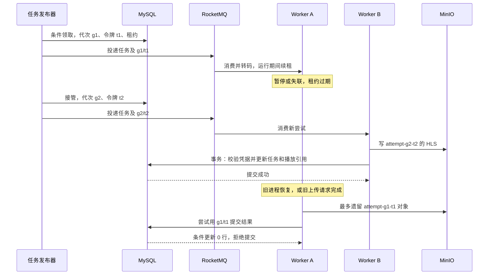

# 亮点一：可靠转码与崩溃接管

[返回面试材料](README.md)

## 问题与目标

上传请求不适合等待完整 FFmpeg 转码。异步处理后又出现新问题：Worker A 卡住或崩溃，租约过期，Worker B 接管；如果 A 恢复运行，它仍可能上传文件、写数据库，覆盖 B 的新结果。

必须保证：只有当前领取者能提交播放地址；旧尝试不能覆盖新尝试的媒体对象；低清档已经可播放时，高档位失败不能破坏已有播放入口。

## 方案与关键结构

| 结构 | 作用 |
| --- | --- |
| `video_transcode_task` | 持久化任务、源文件位置、状态、结果和重试信息 |
| `claim_generation` | 每次领取递增，区分前后尝试 |
| `claim_token`、`lease_until` | 标识具体领取者及有效期，续租与提交都校验 |
| `attempt-<代次>-<令牌>` | 隔离每次转码产物，避免旧上传覆盖新对象 |
| `rendition_status` | 独立描述高档位补偿，区别于“已有内容可播放” |

发布器条件更新领取任务，再向 MQ 投递领取凭据。Worker 校验凭据并在运行期间续租；数据库以任务 ID、状态、代次、令牌和有效期限制结果提交。应用层检查用于及时停止，数据库条件更新才是最终提交边界。

HLS 先写独立目录，再由一个 MySQL 事务更新任务结果和视频播放地址。更新任务命中 0 行就抛异常，禁止更新播放引用。对象存储不参加这个事务，遗留对象由清理任务按引用、租约和保留期检查后回收。

## 核心时序：旧 Worker 迟到

图展示允许出现的迟到写入；实际 Worker 在上传前和上传过程中也检查租约，通常会更早退出。不能保证失租瞬间取消所有在途请求。

## 故障案例与验证

历史真实容器演练：首档 HLS 发布后冻结并终止持有代次 1 的 Worker，另一个 Worker 以代次 2 接管。补偿期间原播放地址保持且 HTTP 读取成功；完成后切换到 `attempt-2-*`，高档位状态完成。

| 证据 | 已验证内容 | 不能推导的结论 |
| --- | --- | --- |
| [9 月 18 日补偿与清理报告](../reports/2026-09-18-transcode-attempt-cleanup-rendition-recovery.md) | 真实 MySQL 接管、MinIO 清理、首档可播放后双 Worker 崩溃恢复 | 所有网络或编码器故障都恢复成功 |
| [MySQL 接管用例](../../bilibili-video-service/src/test/java/com/gary/bilibili/video/mapper/VideoTranscodeRecoveryMySqlIT.java) | 过期可播放任务重新领取，原低清结果保持，旧代次拒绝 | 当前环境已重新执行通过 |
| [结果事务用例](../../bilibili-video-service/src/test/java/com/gary/bilibili/video/service/VideoTranscodeResultServiceIT.java) | 任务结果与视频引用的事务边界 | MinIO 与 MySQL 跨存储强一致 |

历史报告也保留过接管超时失败记录，不能只用一次成功声称长期稳定。复演入口为 `scripts/e2e/p1-reliability-drill.ps1 -CrashAfterPlayable`；需要 Docker、完整服务依赖及足够资源，本次未执行。

## 设计取舍与局限

- **为什么不只加 Redis 锁？** 锁失效后旧进程不会自动停止。最终写入点仍需验证领取权；任务和播放引用都在 MySQL，条件更新直接约束结果提交。
- **为什么不用一个事务包住 FFmpeg？** 长计算会长期占用连接与锁，也不能让对象存储参与数据库回滚。租约负责长任务存活，短事务负责结果提交。
- **为什么目录也要隔离？** 数据库 fencing 只能拒绝播放引用更新，不能撤销已经发给 MinIO 的上传；独立目录避免对象键碰撞。
- **代价是什么？** 更多状态、心跳和清理逻辑。高档位补偿会重新编码源视频，增加计算成本；源文件已被清理时，需要恢复源文件再重排队。
- **尚未证明什么？** FFmpeg 非零退出、挂起、网络超时等完整故障矩阵，以及持续高并发容量。租约接管也不是零等待恢复。

## 90 秒讲述稿

> 这个模块难点在于异步转码之后的并发安全。Worker 的租约过期并不意味着旧进程已经停止，所以我重点分析了旧结果覆盖新结果的问题。项目将任务领取权放在 MySQL，每次领取更新代次和令牌，结果提交必须同时满足领取凭据和租约条件。每次尝试写独立的 HLS 目录，再通过短事务更新任务和视频引用，这样旧 Worker 即使完成在途上传，也无法覆盖新产物或新播放地址。首档可播放与高档位完成分开记录，高档位失败时保留旧播放入口。历史本地演练验证过首档发布后杀掉 Worker，再由第二个 Worker 接管。我会明确说明，这保证的是提交边界和恢复流程，没有实现 MySQL 与 MinIO 的跨存储事务，也没有证明生产容量。

源码入口：[任务条件更新](../../bilibili-video-service/src/main/java/com/gary/bilibili/video/mapper/VideoTranscodeTaskMapper.java)、[结果事务提交](../../bilibili-video-service/src/main/java/com/gary/bilibili/video/service/VideoTranscodeResultService.java)、[历史产物清理](../../bilibili-video-service/src/main/java/com/gary/bilibili/video/service/HlsAttemptCleanupTask.java)。
