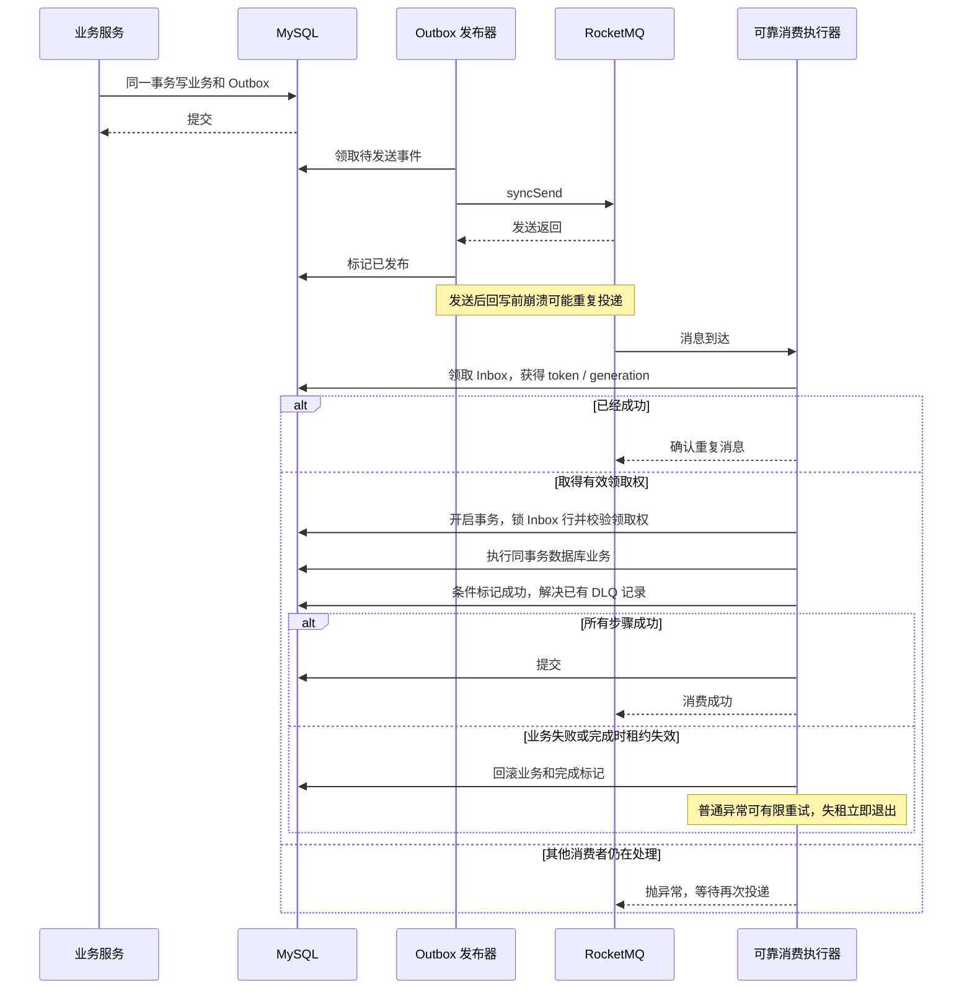

# 亮点二：可靠消息与数据库幂等

[返回面试材料](README.md)

## 问题与目标

三个失败窗口需要分别处理：业务写库成功但发送 MQ 失败；MQ 已收到消息但发送端未记录成功而再次发送；旧消费者租约失效后仍继续执行业务。

目标是在至少一次投递下，让数据库业务与消费成功标记一起提交；重复投递不重复提交已成功业务；持续失败有记录和恢复入口。

## 方案与边界

- **发送侧 Outbox：** 业务变更与待发事件在同一本地事务中保存，发布器异步发送并回写状态。调用方必须正确接入同一事务；独立追加事件的 API 不能替代业务事务的原子性。
- **消费侧 Inbox：** 使用 Topic、消费者组和消息键标识消费身份；领取包含令牌、代次和租约。已成功的重复消息直接确认，仍在处理的竞争投递抛回 Broker，避免提前确认后丢失恢复机会。
- **事务保护：** `MessageInboxLeaseGuard` 在独立事务内锁定当前 Inbox 行，检查领取权，再执行业务回调、成功标记和已有失败记录的解决标记。业务回调必须加入同一事务，不能脱离事务异步写库。
- **失败恢复：** 每次本地重试单独执行事务；重试耗尽后，失败状态与应用 DLQ 同事务保存。默认仍向 Broker 抛异常，因此“单次执行最多重试三次”不等于消息整个生命周期最多执行三次。

## 核心时序：业务与成功标记一起提交

## 真实缺陷：只保护完成回写还不够

旧实现仅用 `PROCESSING` 状态限制回写。A 领取后过期，B 接管，A 迟到的成功或失败回写仍可修改 B 的记录。真实 MySQL 回归先复现了两条失败断言。

只增加 token 检查仍有漏洞：A 可以先修改业务表，再因 token 不符而无法标记完成。如果业务已经独立提交，拒绝完成标记不能撤销副作用。

修复把**业务数据库写入与成功标记放入受 Inbox 行锁保护的同一事务**。B 的接管不能越过 A 正在执行的事务；若 A 执行期间租约到期，完成校验失败使业务回滚，B 随后才能接管。失租消费者也不能写新领取者的 DLQ。

## 验证证据

[2026-10-10 修复报告](../reports/2026-10-10-inbox-lease-fencing.md)记录：7 条执行器单测、9 条真实 MySQL 测试、2 条弹幕写入测试通过；当次完整后端 118 个测试通过且无跳过，Compose 业务验收通过。该轮没有运行故障演练选项和 k6 持续压测。

[真实 MySQL 测试](../../bilibili-video-service/src/test/java/com/gary/bilibili/video/reliability/MessageInboxLeaseMySqlIT.java)重点检查：旧成功/失败回写被拒绝；过期回调不写业务；执行中失租回滚；并发接管等待旧事务回滚；非幂等计数只有新消费者的一次提交；失败记录和迁移保持正确。

这里描述的是历史记录和当前用例内容，本次没有重新运行这些测试。

## 设计取舍与局限

| 追问 | 回答要点 |
| --- | --- |
| 为什么不用 Redis `SETNX` 去重？ | 去重标记与 MySQL 业务无法自然原子提交，仍有“先标记后失败”或“业务成功未标记”的窗口。当前方案把数据库副作用与标记放在同一事务。 |
| 能称为 Exactly Once 吗？ | 不能。消息可以重复，业务回调也可能执行后回滚；约束的是相同消费身份下受保护的数据库提交，不是整个分布式系统只执行一次。 |
| 为什么转码不直接复用这个长事务？ | 转码生命周期长，涉及外部计算与对象存储；采用专用任务租约和短结果事务更合适。 |
| Redis、ES 调用失败怎么办？ | MySQL 回滚不能撤销外部操作，需要独立幂等、重建或补偿，不能把 Inbox 行锁当成跨存储原子性。 |
| 有哪些性能代价？ | 行锁和连接会被回调占用。可靠弹幕消费改为事务内逐条写库，减少批量写入收益，需要重新测吞吐与 MQ 积压。 |
| 事件是否一定最终发出？ | Outbox 有重试上限，长期故障可能耗尽重试；需要监控、排障和明确补偿，不能承诺无限自动恢复。 |

## 90 秒讲述稿

> 这个模块把发送丢失、重复消费和消费者接管拆开解决。业务与 Outbox 在同一事务提交，发送器之后投递 MQ；因为发送成功后可能来不及回写，所以消费端仍必须幂等。最有价值的故障是 Inbox 租约过期后，旧消费者还能回写新消费者的状态。进一步分析发现，只给完成更新加 token 也不够，旧消费者可能已经改了业务表。因此现在通过行锁验证当前领取权，让数据库业务与成功标记一起提交；租约失效就一起回滚。历史真实 MySQL 测试验证了并发接管和非幂等计数只提交一次。这个保证只覆盖加入同一事务的数据库操作，Redis、ES 仍要单独处理，逐条事务落库的吞吐代价也需要压测。

源码入口：[Outbox 事务 API](../../bilibili-common/src/main/java/com/gary/bilibili/common/reliability/OutboxEventService.java)、[发送器](../../bilibili-common/src/main/java/com/gary/bilibili/common/reliability/OutboxEventPublisher.java)、[消费执行器](../../bilibili-common/src/main/java/com/gary/bilibili/common/reliability/ReliableMessageExecutor.java)、[事务保护](../../bilibili-common/src/main/java/com/gary/bilibili/common/reliability/MessageInboxLeaseGuard.java)、[Inbox SQL](../../bilibili-common/src/main/java/com/gary/bilibili/common/reliability/MessageInboxRepository.java)。
