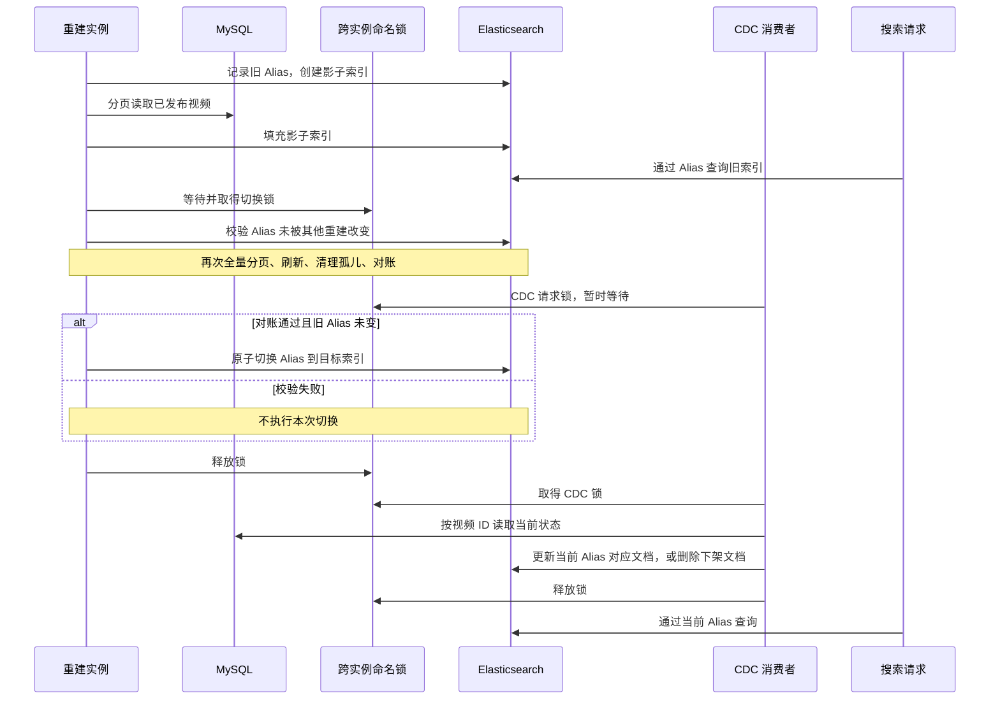

# 亮点三：搜索索引恢复与并发 CDC

[返回面试材料](README.md)

## 问题与目标

MySQL 是视频业务事实源，ES 是可重建读模型。直接清空线上索引再导入会留下搜索空窗；重建期间视频仍在变化，多实例可能同时重建；较早的 CDC 事件晚到时，还可能覆盖新标题。

目标是让旧 Alias 在准备阶段继续服务查询，仅在目标索引校验后切换；并发重建不能覆盖其他实例已经完成的切换；晚到 CDC 不能把事件中的旧快照直接写回 ES。

## 方案

1. 记录当前 Alias 指向的物理索引，创建版本化影子索引，按 ID 分页导入 MySQL 已发布视频。此阶段不持有跨实例切换锁。
2. 取得共享 MySQL 命名锁，再进入实例内切换写锁；核对 Alias 仍指向开始时的旧索引，否则终止该次重建。
3. 在临界区再次分页读取 MySQL、刷新索引、删除孤儿文档并对账；一致后原子更新 Alias 指向。
4. 视频及视频统计 CDC 与切换共用跨实例锁。消费时用事件中的 ID 回查 MySQL 当前已发布状态，再更新或删除索引文档，不直接信任旧快照。

“最终追平”在当前实现中是再次全量分页读取，不是基于 Binlog 位点的增量追平。锁协调的是索引写入与切换，不会冻结所有业务表更新，因此系统仍是最终一致，不能声称切换时刻获得了全库强一致快照。

## 核心时序

## 故障案例：切换成功但标题回退

历史双实例演练并发触发索引重建，同时顺序提交 20 次视频标题更新。一次运行中切换已完成，最终对账却超时：消费端按 CDC 事件快照写 ES，晚到旧事件覆盖了新标题。

修复后，视频 CDC 持锁回查 MySQL 当前状态再写索引。这样较早事件晚到时也读取当前事实，而不是把旧标题写回。另一个发现是切换锁立即领取失败导致两个重建都失败，调整为最多等待 30 秒；这只是等待上限，不是重建耗时上限。

## 验证证据与口径

[2026-09-18 锁等待与 CDC 报告](../reports/2026-09-18-index-cutover-lock-cdc-backlog.md)记录了真实 MySQL、Canal、RocketMQ、ES 和两个 Canal 应用实例的单次本地短突发结果：

| 检查 | 历史结果 |
| --- | --- |
| 源表更新 / Outbox 捕获 / Inbox 成功 | 20 / 20 / 20 |
| 更新结束到 Inbox 全部成功 | 2,659 ms |
| 并发重建 | 一个成功，另一个因 Alias 已改变而拒绝 |
| 最终 Alias 与业务检查 | 指向一个物理索引，最新标题可搜索，对账一致 |
| 观测到的已捕获未消费峰值 | 14 条，采样结果是峰值下界 |

这些数值不是生产 SLO，也不是 P95/P99；表中的积压来自 Outbox/Inbox 采样，不是 RocketMQ Broker 队列深度。旧版本的演练不能证明最近 Inbox 事务修改后同样负载仍有相同结果。

[索引维护测试](../../bilibili-canal-service/src/test/java/com/gary/bilibili/canal/service/SearchIndexMaintenanceServiceTest.java)包含分页构建后切换、对账失败保留原 Alias、拒绝无关回滚目标等用例。复演入口为 `scripts/e2e/p1-reliability-drill.ps1 -MeasureIndexCutover`，本次未执行。

## 设计取舍与局限

- **为什么用影子索引？** 准备失败时仍保留查询入口，代价是额外空间和重复导入成本；这不能保证 ES 整体故障时搜索可用。
- **为什么需要跨实例锁和旧 Alias 校验？** 进程内锁管不了另一个实例。两个实例都可能完成准备，后完成者取得锁后还必须确认自己基于的 Alias 没变，防止覆盖已完成的切换。
- **为什么选 MySQL 命名锁？** 复用当前基础设施，锁绑定数据库连接。适用于现有同一 MySQL 协调范围，没有证明跨数据库或跨地域适用。
- **临界区一定很短吗？** 不一定。准备阶段移出锁，但临界区仍有全量重扫、刷新、清理和对账，数据量增长会延长 CDC 等待。后续应先量化数据规模、持锁时间和积压，再考虑带位点的增量方案。
- **回滚是否恢复历史内容？** 当前回滚会对保留索引重新填充并校验当前 MySQL 数据，再切换；不是业务数据的时间点恢复。
- **还可改什么？** 历史并发冲突以 HTTP 500 返回，后续可以提供明确的冲突状态或任务查询。没有必要为了面试先增加新的协调中间件。

## 90 秒讲述稿

> 搜索是从 MySQL 派生的读模型，所以我重点准备的是它如何被重建。项目先在影子索引导入数据，让查询继续走旧 Alias；切换前通过 MySQL 命名锁协调各实例和 CDC，再检查原 Alias、重扫和对账，通过后才切换。真实演练发现过切换成功但标题回退，原因是晚到的 CDC 旧事件覆盖新数据。修复后事件只提供视频 ID，消费者持锁读取 MySQL 当前状态再写 ES。历史双实例演练中，20 次更新都被消费，最终标题和 Alias 检查通过。不过当前最终追平仍是全量重扫，持锁时间会随规模增长，而且锁没有冻结业务写入，所以这是最终一致的恢复设计，不是全库强一致切换。

源码入口：[索引维护](../../bilibili-canal-service/src/main/java/com/gary/bilibili/canal/service/SearchIndexMaintenanceService.java)、[CDC 消费](../../bilibili-canal-service/src/main/java/com/gary/bilibili/canal/consumer/CacheSyncConsumer.java)、[跨实例锁](../../bilibili-canal-service/src/main/java/com/gary/bilibili/canal/service/MySqlNamedLock.java)、[实例内锁](../../bilibili-canal-service/src/main/java/com/gary/bilibili/canal/service/VideoIndexWriteGate.java)、[Alias 操作](../../bilibili-canal-service/src/main/java/com/gary/bilibili/canal/service/VideoIndexAlias.java)。
