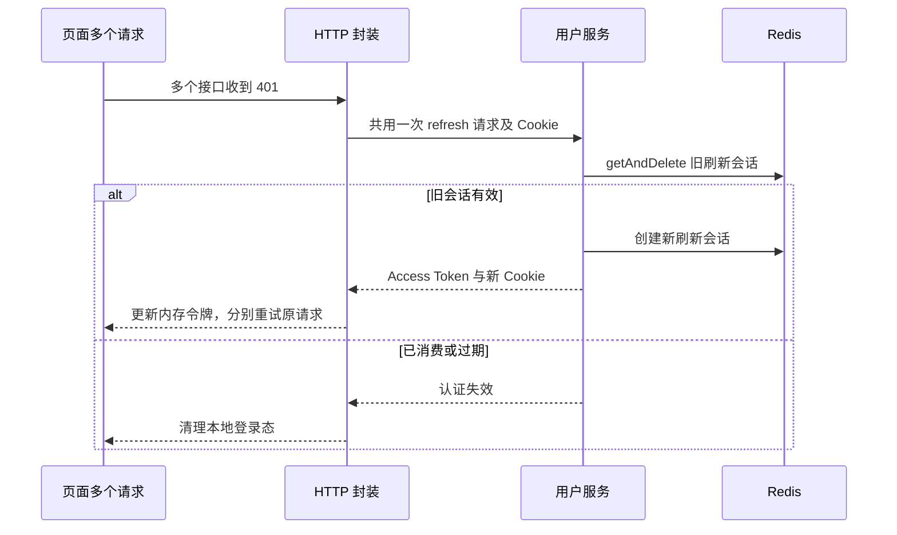

# 亮点四：登录会话轮换与并发刷新

[返回总览](README.md)。证据口径见总览：源码与用例已核对，本次没有重跑。

## 问题

长期凭据放进前端存储会扩大泄露影响；Access Token 过期时，页面多个请求同时返回 401，若分别刷新，会争抢一次性 Refresh Token。目标是缩短访问凭据生命周期，同时让正常用户平滑恢复。

## 方案与结构

使用 Sa-Token 访问会话，前端 Access Token 保存在模块内存。Refresh Token 为 32 字节安全随机数，Redis 使用 SHA-256 摘要作为键，保存用户和终端信息；原始值写入 HttpOnly Cookie。刷新时 `getAndDelete` 原子消费旧会话，再签发访问会话与新刷新 Cookie。退出撤销当前刷新凭据，修改密码调用全用户刷新会话撤销。

前端用共享 `refreshPromise` 合并同一页面内的并发刷新，并用 `_authRetry` 限制原请求只刷新重试一次；独立刷新客户端避免拦截器递归。

## 核心时序

## 故障案例与验证

**用例场景：** 两个请求同时 401，断言只发生一次刷新；刷新失败则清理会话，刷新端点自身失败不得递归。[HTTP 测试](../../bilibili-web/src/api/http.test.ts)覆盖这些分支。[历史前端报告](../reports/2026-09-17-frontend-regression.md)记录当时相关回归通过。

[用户 API 集成测试](../../bilibili-user-service/src/test/java/com/gary/bilibili/user/api/UserApiIT.java)使用真实 MySQL/Redis 验证迁移、注册、登录和用户查询；它不能被解释成完整刷新安全审计。[Cookie 测试](../../bilibili-user-service/src/test/java/com/gary/bilibili/user/service/RefreshCookieServiceTest.java)检查 Cookie 行为。建议补演：两个标签页同时刷新、消费旧凭据后服务崩溃，这两项本次没有运行。

## 设计取舍、局限与追问

- **为什么保存摘要？** Redis 记录泄露时不直接暴露原始刷新凭据；不能因此声称整个认证系统已抵御泄露。
- **HttpOnly 能防所有攻击吗？** 它限制脚本读取 Cookie，但不阻止恶意脚本以用户身份请求。Secure、SameSite 和路径是配置项，应结合实际 HTTPS 与同站部署解释。
- **轮换完全原子吗？** 旧凭据消费、访问会话创建、新刷新会话写入是多步操作；中途失败可能要求重新登录。`revokeAll` 与新会话签发也未证明并发原子性。
- **并发刷新覆盖多标签页吗？** 当前 Promise 仅在一个页面运行时内共享，没有跨标签页协调。
- **验证码是完整短信系统吗？** 当前代码生成并缓存验证码，不能把它描述为已经对接真实短信运营商。

## 90 秒讲述稿

> 我把登录恢复拆成短期访问会话和可轮换刷新会话。刷新凭据通过 HttpOnly Cookie 传递，Redis 只以摘要索引，一次刷新会消费旧凭据。前端多个接口同时过期时共用一个 Promise，避免自己竞争一次性凭据；原请求最多刷新重试一次。已有测试覆盖并发 401、刷新失败清理和防递归。不过这只解决同页面并发，多标签页和轮换中途失败仍需额外处理，不能把 HttpOnly 当成完整安全保证。

源码：[刷新会话](../../bilibili-user-service/src/main/java/com/gary/bilibili/user/service/RefreshSessionService.java)、[Cookie](../../bilibili-user-service/src/main/java/com/gary/bilibili/user/service/RefreshCookieService.java)、[刷新控制器](../../bilibili-user-service/src/main/java/com/gary/bilibili/user/controller/UserController.java)、[HTTP 封装](../../bilibili-web/src/api/http.ts)。
