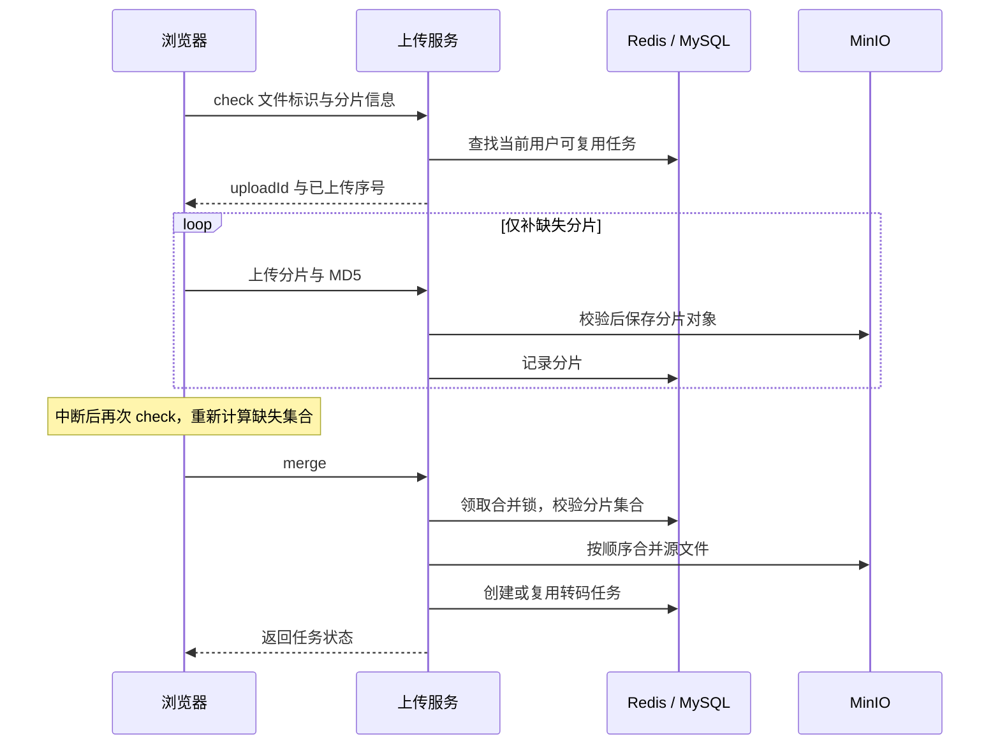

# 亮点五：断点续传、重复分片与预签名直传

[返回总览](README.md)。本篇区分上传和后续[可靠转码](01-media-recovery.md)。

## 问题与方案

大文件上传遇到断网、页面刷新或响应丢失时，应避免从头上传，也不能让用户拼接其他人的分片。项目按 5 MiB 分片，服务端任务绑定用户、文件标识、文件大小和分片数量，记录已上传序号；前端重新检查任务后跳过已完成分片。单片校验 MD5，重复分片可返回成功，合并前检查完整性与顺序。

合并使用带随机值的 Redis 锁并比较值释放，减少同任务重复合并。已满足秒传条件的文件可直接复用结果；这是复用路径，不是文件所有权或版权证明。

另有预签名 PUT 直传：服务端创建绑定用户的上传会话和 15 分钟 URL，客户端直接上传 MinIO；完成接口验证所有者、状态、期限、对象大小和 ETag，再在数据库事务中标记会话完成并创建转码任务。

## 核心时序

## 故障案例与验证

**测试案例：** 某分片网络请求失败，重新执行上传时先向服务器查询进度，跳过已接受分片，最终合并相同任务。[前端上传测试](../../bilibili-web/src/services/chunkUpload.test.ts)覆盖中断恢复、跳片与秒传；[后端上传测试](../../bilibili-video-service/src/test/java/com/gary/bilibili/video/service/impl/UploadServiceImplTest.java)覆盖重复分片、分片数量不符、进度与用户任务隔离。

历史浏览器恢复验证使用网关桩，见[前端报告](../reports/2026-09-17-frontend-regression.md)；[容量报告](../reports/2026-09-18-p2-capacity-baseline.md)记录过预签名访问需保留原 Host 的实际问题及真实转码链路复验。不能把接口桩成功算作真实大文件断网验收。

## 设计取舍、局限与追问

- **为什么查服务端进度？** 响应丢失不等于服务端没保存，客户端本地进度不是最终依据。
- **MD5 有何用途？** 用于当前实现中的文件标识与传输校验，不是对恶意文件的安全认证；直传的 ETag 与 MD5 对比依赖当前单 PUT 使用方式，不能泛化到分段上传或所有对象存储模式。
- **Redis 锁是否完全排除重复合并？** 固定 5 分钟租期没有证明覆盖所有大文件耗时，失租后旧执行者仍可能运行。不能照搬转码代次保护的结论到合并链路。
- **直传为什么有完成接口？** 客户端“上传成功”不能直接作为业务事实，服务端必须核验对象。但预签名 URL 在有效期内的再次使用、完成后对象可变性仍需专门约束和测试。
- **后续验证：** 跨用户请求、最后一个分片响应丢失、合并超过锁期限、直传过期及重复完成；未声称本次演练完成。

## 90 秒讲述稿

> 断点续传的核心是让服务端维护可信进度。任务绑定用户和文件信息，每次恢复先查已上传序号，只补缺失分片，重复上传不应改变结果。大文件还可以使用短期预签名 URL 绕过应用服务器传输，完成后由服务端核验对象再创建转码任务。这里最容易混淆的是上传成功与业务完成，以及 MD5 和安全认证的区别。当前固定合并锁租期和直传 URL 有效期内的对象保护仍有边界，需要真实故障测试，不能只凭前端进度条认为链路完整可靠。

源码：[上传服务](../../bilibili-video-service/src/main/java/com/gary/bilibili/video/service/impl/UploadServiceImpl.java)、[直传服务](../../bilibili-video-service/src/main/java/com/gary/bilibili/video/service/DirectUploadService.java)、[前端续传](../../bilibili-web/src/services/chunkUpload.ts)。
