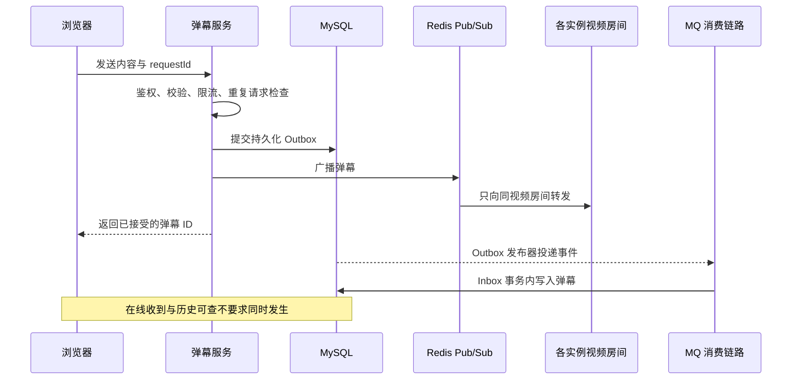

# 亮点六：弹幕实时广播与可靠落库分层

[返回总览](README.md)。消息事务基础见[消息一致性](02-message-consistency.md)。

## 问题与方案

弹幕同时需要在线低延迟、跨实例房间广播和可查询历史。单用 Redis Pub/Sub 没有离线重放，逐条同步等待完整持久化链路又会增加响应等待。

当前发送入口检查已发布视频、内容长度和用户滑动窗口限流，以用户和 requestId 预留重复请求标识；先写持久化 Outbox，再更新短期统计并广播。Redis Pub/Sub 扩散到各实例的 Netty 房间；无订阅者或发布异常时退回本机广播。MQ 消费经 Inbox 保护后写 MySQL，在线推送和最终持久化是两个完成条件。

登录用户用短期一次性 Ticket 建立 WS 身份，绑定用户与视频，Redis 原子取出删除。前端心跳、掉线重新取票、页面销毁停止重连，避免旧页面回调污染新页面。

## 核心时序

## 故障案例与验证

**已有测试场景：** 重复 requestId 返回已有 ID；Ticket 只能消费一次且只能用于绑定视频；房间不能串播；连接断开后重新取票；退出页面后不再重连。[发送测试](../../bilibili-danmu-service/src/test/java/com/gary/bilibili/danmu/service/impl/DanmuServiceImplTest.java)、[Ticket 测试](../../bilibili-danmu-service/src/test/java/com/gary/bilibili/danmu/service/DanmuWebSocketTicketServiceTest.java)、[房间测试](../../bilibili-danmu-service/src/test/java/com/gary/bilibili/danmu/netty/DanmuRoomManagerTest.java)、[前端连接测试](../../bilibili-web/src/services/danmuConnection.test.ts)提供断言入口。

真实历史变更是 Inbox 事务不能与后台批量 flush 共享，于是可靠消费改为调用线程内落库，见[修复报告](../reports/2026-10-10-inbox-lease-fencing.md)。事务外调用仍保留批量队列，不能据此宣称可靠消费仍全部批量写入。

## 设计取舍、局限与追问

- **Redis 挂了还能广播吗？** 发布器有本机降级，但发送前的去重和限流也依赖 Redis，整个发送接口不能承诺 Redis 故障时无损可用。
- **重连能补齐漏掉的弹幕吗？** 当前重连恢复后续接收，不等于带确认游标的缺口补偿。Pub/Sub 不提供离线可靠投递。
- **requestId 是否端到端原子幂等？** Redis 预留与 MySQL Outbox 不是一个事务；进程在两步之间崩溃存在窗口，不能将其描述成严格一次接受。
- **Ticket 为什么比长期 token 好？** 减少 URL 中暴露长期凭据的风险；Ticket 仍是敏感短期凭据，不应随意记录或复用。
- **下一项压测：** 持续消息速率、房间人数、慢客户端、MQ 积压及最终落库数量；现有每秒 1 条的短时报告不是高并发结论。

## 90 秒讲述稿

> 我把弹幕在线广播和历史持久化分开。发送先留下 Outbox，Redis Pub/Sub 负责跨实例实时分发，Netty 按视频隔离房间，MQ 和数据库负责历史数据。连接用一次性短期 Ticket，前端掉线重新取票，页面退出会取消重连。最近的可靠消费修复也说明一致性会影响性能：为了让 Inbox 与弹幕写入同事务，需要在消费线程内写库，不能交给后台 flush。当前重连不保证补齐断线期间所有消息，Redis 本机广播降级也不能代表整个发送链路不依赖 Redis。

源码：[发送服务](../../bilibili-danmu-service/src/main/java/com/gary/bilibili/danmu/service/impl/DanmuServiceImpl.java)、[广播](../../bilibili-danmu-service/src/main/java/com/gary/bilibili/danmu/netty/DanmuBroadcastPublisher.java)、[连接生命周期](../../bilibili-web/src/services/danmuConnection.ts)。
