# 亮点七：社交关系幂等、评论权限与计数边界

[返回总览](README.md)。涵盖关注、点赞、评论、收藏及收藏夹。

## 问题与方案

重复点赞或收藏不应重复增加计数，取消操作应可重复；评论删除需要区分评论作者、视频作者与管理员；收藏不能写进其他用户的收藏夹。

关系操作通过数据库激活、插入和停用表达状态变化，点赞与收藏根据影响行数决定是否更新统计及发送创作者统计变更事件。查询关系状态以数据库为依据，Redis 集合用于缓存。评论采用顶层评论与回复组织，删除支持受权限约束的评论树处理；收藏夹操作校验当前登录用户归属。

视频点赞、收藏与评论计数和各自的业务变更共用 MySQL 事务。Flyway V12 从现有业务事实重算历史计数，详情缓存由既有 CDC 链路失效。

## 核心时序：重复点赞

```mermaid
sequenceDiagram
    participant B as 用户
    participant S as 点赞服务
    participant DB as MySQL
    participant R as Redis
    B->>S: 点赞目标
    S->>DB: 激活关系或插入有效关系
    alt 本次确实改变关系
        S->>DB: 同事务更新视频计数
        S->>DB: 同事务写创作者统计变更 Outbox
    else 已是有效关系
        Note over S: 不重复增加计数
    end
    S->>R: 更新关系缓存
    S-->>B: liked=true
```

## 故障案例与验证

**用例案例：** 重复点赞与重复收藏的数据库变化为零，断言统计不再次增加；禁止关注自己；视频作者删除评论树；收藏夹分页与默认收藏夹行为。对应[点赞测试](../../bilibili-social-service/src/test/java/com/gary/bilibili/social/service/impl/LikeServiceImplTest.java)、[收藏测试](../../bilibili-social-service/src/test/java/com/gary/bilibili/social/service/impl/CollectionServiceImplTest.java)、[评论测试](../../bilibili-social-service/src/test/java/com/gary/bilibili/social/service/impl/CommentServiceImplTest.java)、[关注测试](../../bilibili-social-service/src/test/java/com/gary/bilibili/social/service/impl/FollowServiceImplTest.java)。这些服务 Mock 用例不等于真实数据库并发压测。

旧实现会在 MySQL 成功增加计数、Redis 尚未扣减时留下重放窗口。V12 版本把投影和关系变更一起提交；回滚后两者一起恢复，提交后重复请求由关系状态判定是否需要计数。

## 设计取舍、局限与追问

- **为什么检查影响行数？** 区分状态真的改变和重复请求；唯一约束、SQL 条件以及事务共同决定并发结果，不能只靠 Java 的先查后写。
- **热点视频如何影响写入？** 同一视频的计数更新会竞争统计行锁。容量仍需按实际互动到达率复测。
- **页面何时能看到新计数？** MySQL 提交即生效。详情缓存由 CDC 异步失效，页面可短暂读到旧值。
- **评论是否无限递归树？** 应按当前顶层/回复模型讲解，不要把页面嵌套效果扩写成任意深度评论引擎。
- **哪些适合简历？** 幂等状态转换和权限边界可讲；普通增删改查适合作为业务完整性支撑，不必每个接口都单列亮点。

## 90 秒讲述稿

> 点赞、收藏先根据数据库影响行数判断关系是否发生变化，再在同一事务里更新视频计数。评论删除按实际删除的条数扣减。旧版 Redis 增量可能在数据库加完、Redis 未扣时被重复消费，所以升级时从原始点赞、收藏和评论记录重算一遍。提交后仍通过 CDC 刷新详情缓存。

源码见[点赞](../../bilibili-social-service/src/main/java/com/gary/bilibili/social/service/impl/LikeServiceImpl.java)、[评论](../../bilibili-social-service/src/main/java/com/gary/bilibili/social/service/impl/CommentServiceImpl.java)、[收藏](../../bilibili-social-service/src/main/java/com/gary/bilibili/social/service/impl/CollectionServiceImpl.java)及[历史计数重算](../../bilibili-common/src/main/resources/db/migration/V12__reconcile_video_interaction_stats.sql)。
