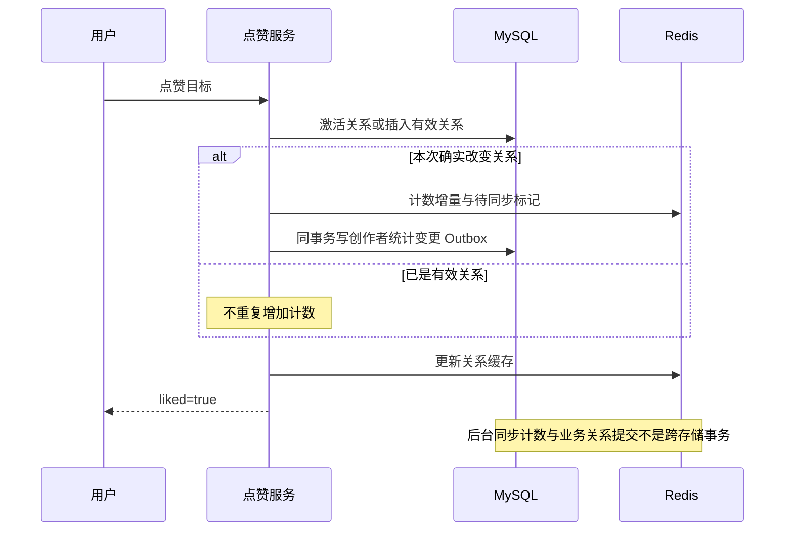

# 亮点七：社交关系幂等、评论权限与计数边界

[返回总览](README.md)。涵盖关注、点赞、评论、收藏及收藏夹。

## 问题与方案

重复点赞或收藏不应重复增加计数，取消操作应可重复；评论删除需要区分评论作者、视频作者与管理员；收藏不能写进其他用户的收藏夹。

关系操作通过数据库激活、插入和停用表达状态变化，点赞与收藏根据影响行数决定是否更新统计及发送创作者统计变更事件。查询关系状态以数据库为依据，Redis 集合用于缓存。评论采用顶层评论与回复组织，删除支持受权限约束的评论树处理；收藏夹操作校验当前登录用户归属。

视频互动计数使用 Redis Hash 增量及待同步集合，Lua 将增量与标脏一起写入 Redis，后台定时同步数据库。注意：Lua 只保证 Redis 内部原子性，不覆盖关系数据库事务。

## 核心时序：重复点赞

## 故障案例与验证

**用例案例：** 重复点赞与重复收藏的数据库变化为零，断言统计不再次增加；禁止关注自己；视频作者删除评论树；收藏夹分页与默认收藏夹行为。对应[点赞测试](../../bilibili-social-service/src/test/java/com/gary/bilibili/social/service/impl/LikeServiceImplTest.java)、[收藏测试](../../bilibili-social-service/src/test/java/com/gary/bilibili/social/service/impl/CollectionServiceImplTest.java)、[评论测试](../../bilibili-social-service/src/test/java/com/gary/bilibili/social/service/impl/CommentServiceImplTest.java)、[关注测试](../../bilibili-social-service/src/test/java/com/gary/bilibili/social/service/impl/FollowServiceImplTest.java)。这些服务 Mock 用例不等于真实数据库并发压测。

**建议演练，尚未执行：** 数据库计数更新成功、Redis 增量扣减之前杀进程，检查恢复后是否重复累加。当前源码存在跨存储完成窗口，因此材料不声称计数严格不重不漏。

## 设计取舍、局限与追问

- **为什么检查影响行数？** 区分状态真的改变和重复请求；唯一约束、SQL 条件以及事务共同决定并发结果，不能只靠 Java 的先查后写。
- **关系与计数为何分开？** 降低热点统计行写压力，但允许展示值延迟，还引入增量丢失或重复的恢复问题。
- **数据库回滚会撤回 Redis 增量吗？** 不会。当前事务中发生的外部写入仍有一致性边界，建议以关系事实重算或更严格的事件消费补偿，而非宣称已彻底解决。
- **评论是否无限递归树？** 应按当前顶层/回复模型讲解，不要把页面嵌套效果扩写成任意深度评论引擎。
- **哪些适合简历？** 幂等状态转换和权限边界可讲；普通增删改查适合作为业务完整性支撑，不必每个接口都单列亮点。

## 90 秒讲述稿

> 社交模块重点不是接口数量，而是重复请求和权限。点赞、收藏用数据库状态变化决定是否计数，重复请求返回相同业务状态；评论删除和收藏夹访问都需要校验操作者。计数使用 Redis 增量再异步同步，减轻热点行写入，但这也留下跨存储窗口。已有测试验证重复操作不再调用计数更新，却不能证明进程在任意两步间崩溃都不重不漏。面试时我会把关系事实和展示统计分开解释，并把事实重算作为后续改进方向。

源码：[点赞](../../bilibili-social-service/src/main/java/com/gary/bilibili/social/service/impl/LikeServiceImpl.java)、[评论](../../bilibili-social-service/src/main/java/com/gary/bilibili/social/service/impl/CommentServiceImpl.java)、[收藏](../../bilibili-social-service/src/main/java/com/gary/bilibili/social/service/impl/CollectionServiceImpl.java)、[统计同步](../../bilibili-social-service/src/main/java/com/gary/bilibili/social/task/SocialStatsSyncTask.java)。
