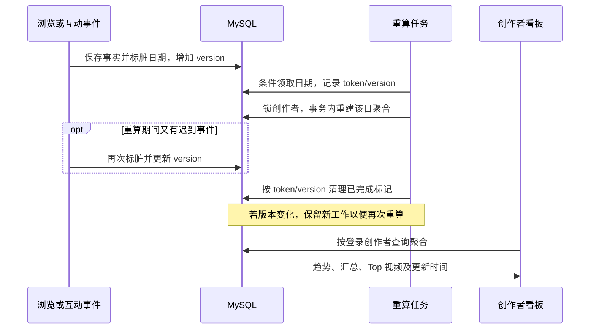

# 亮点八：可重算的创作者数据中心

[返回总览](README.md)。涵盖浏览事件、互动汇总、趋势、热门视频与身份隔离。

## 问题与方案

实时页面计数不足以回答“某位创作者每天获得多少互动”。事件可能重复或迟到，取消点赞、删除评论也会改变历史口径，直接累计难以纠错。

项目将浏览事件按 requestId 去重保存，以事件日期标记创作者脏日期；互动变更也发布标脏消息。后台领取日期任务，锁定创作者行，在一个事务中删除并重建当日视频统计。完成清理同时检查领取 token 与 dirty_version，避免重算期间新事件产生的脏标记被旧任务删除。

看板的 creatorId 从登录态取得，不接受客户端任意选择身份。默认查询 7 天，最多 90 天，手动重算最多 31 天；趋势对缺失日期补零，返回汇总、Top 视频和聚合时间。

## 核心时序

## 故障案例与验证

[真实 MySQL 用例](../../bilibili-video-service/src/test/java/com/gary/bilibili/video/repository/CreatorAnalyticsMySqlIT.java)覆盖重复聚合、迟到数据和创作者隔离；[服务测试](../../bilibili-video-service/src/test/java/com/gary/bilibili/video/service/CreatorAnalyticsServiceTest.java)覆盖看板与日期边界。[10 月 10 日报告](../reports/2026-10-10-inbox-lease-fencing.md)记录 Compose 验证了身份隔离、自动统计与迟到数据重算。不是本次新执行结果。

建议补演：领取后崩溃、聚合提交后未清理标记、多个实例同时处理同一创作者；检查重跑的最终值与任务收敛。本篇不把源码中的版本检查直接算作全部并发场景已实测通过。

## 设计取舍、局限与追问

- **为什么重算而不是全部加一？** 重复执行更容易收敛，也能纳入迟到和撤销；代价是读取事实表和聚合开销。
- **指标究竟是什么？** 浏览按记录事件统计；点赞、收藏按当前有效关系的创建日期归属；评论、弹幕按当前可见状态筛选。不是完整的“当天所有行为次数”，也不是唯一访客数。
- **为何锁创作者行？** 简单串行化同一创作者聚合，但多个日期也会竞争该行，大创作者吞吐可能受限。
- **看板实时吗？** 后台默认按周期扫描，MQ 与任务也可能积压；缺失日期显示零不代表绝对没有活动，应结合更新时间。
- **能恢复到任意历史状态吗？** 不能。当前关系表与删除/屏蔽状态重算的是现有事实口径；完整行为历史需要独立事件模型。所有影响可见性的写入路径是否都标脏，也需完整审计。

## 90 秒讲述稿

> 创作者数据中心的亮点是统计可以重算。浏览事件去重后记录发生日期，互动变化把对应日期标脏，后台按创作者和日期重建聚合。清理任务时检查 token 和版本，避免把重算期间的新变化抹掉。身份来自登录态，所以用户不能传别人的 ID 查询看板。已有真实 MySQL 和历史 Compose 证据覆盖重复、迟到和隔离。需要特别说明口径：点赞是当前有效关系按创建日期归属，并不是完整操作流水；查询也存在聚合延迟。

源码：[聚合仓库](../../bilibili-video-service/src/main/java/com/gary/bilibili/video/repository/CreatorAnalyticsRepository.java)、[重算事务](../../bilibili-video-service/src/main/java/com/gary/bilibili/video/service/CreatorAnalyticsAggregator.java)、[后台任务](../../bilibili-video-service/src/main/java/com/gary/bilibili/video/task/CreatorAnalyticsRebuildTask.java)、[看板服务](../../bilibili-video-service/src/main/java/com/gary/bilibili/video/service/CreatorAnalyticsService.java)。
