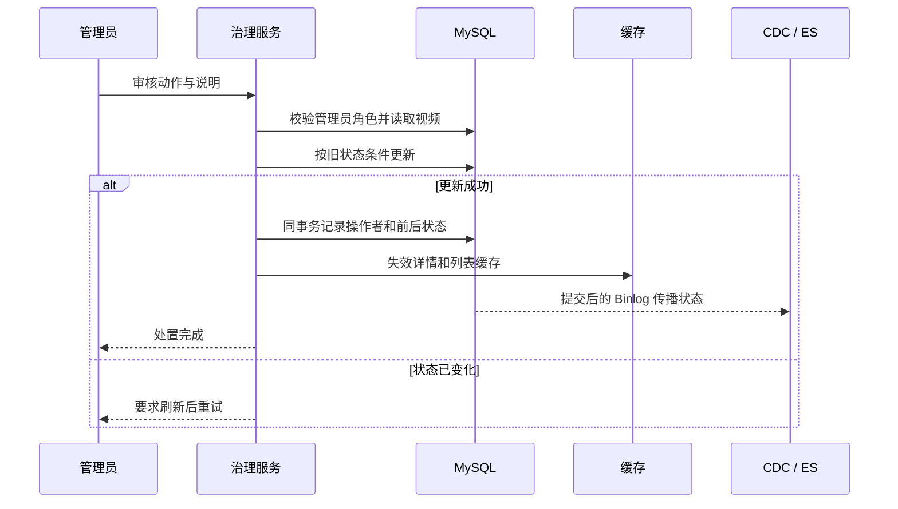

# 亮点九：内容审核、举报处置与审计

[返回总览](README.md)。覆盖投稿风控、人工审核、下架恢复、举报和操作留痕。

## 问题与方案

视频转码完成不代表内容可以公开。项目区分媒体准备与发布状态，投稿经过关键词、标签数量、发布频率和重复文本等规则评分，记录风险决策；后台提供审核与举报处置。

管理员身份从登录用户及数据库角色校验，前端隐藏按钮不是授权。审核更新带旧状态条件，影响行数不为一就拒绝陈旧操作；视频状态与审核日志在同一数据库事务中保存。发布/恢复还检查播放地址存在。举报覆盖视频、评论和弹幕，重复举报通过数据库异常转为业务错误，处置结果条件更新防止直接覆盖已处理状态。

## 核心时序

## 故障案例与验证

**测试场景：** 风险规则命中后输出相应决策，见[规则测试](../../bilibili-video-service/src/test/java/com/gary/bilibili/video/service/ContentRiskServiceTest.java)。[演示手册](../MEDIA_GOVERNANCE_RUNBOOK.md)说明上传、待审核、批准、搜索可见和举报处置流程，它是操作指南，不是完整并发治理验收证明。

**建议演练，未执行：** 两位管理员读取同一状态后同时审批/下架；验证旧状态条件冲突、日志与状态提交一致；模拟 Redis 故障后检查数据库回滚与缓存现状。不要把源码存在条件更新写成已证明所有并发序列安全，状态变化后又恢复原值的 ABA 情形也未由独立版本号解决。

## 设计取舍、局限与追问

- **规则审核是否 AI 内容识别？** 不是。当前是可解释的文本与频率规则，不能识别视频画面全部风险，也没有误报率、召回率实测。
- **审计有何价值？** 能说明谁在何时做了什么、前后状态与原因；这不等于日志具备防篡改存储。
- **下架是否立即封禁所有播放？** 应用状态、缓存、ES 和已分发媒体 URL 有不同传播边界，不能承诺已获得的对象地址立即失效。
- **事务覆盖缓存吗？** 不覆盖。失效动作发生在数据库事务周边，异常和回滚可能留下短时差异，需结合 CDC 与缓存策略分析。
- **权限模型复杂吗？** 目前是管理员角色检查与部分运维令牌接口，不应描述成完整多租户 RBAC/ABAC 权限平台。

## 90 秒讲述稿

> 内容治理把转码成功和允许公开分开。发布前记录规则风险，管理员审批、下架和恢复都在服务端校验身份，并通过旧状态条件避免直接覆盖其他人的修改。状态和审计日志在同一事务中保存，方便解释处置过程。但它目前是规则与人工审核闭环，不是 AI 内容安全系统；下架也不能等同于瞬间撤销所有已经分发的媒体 URL。下一步验证重点是并发处置、缓存失败和历史操作可追溯性。

源码：[治理服务](../../bilibili-video-service/src/main/java/com/gary/bilibili/video/service/ContentGovernanceService.java)、[风险规则](../../bilibili-video-service/src/main/java/com/gary/bilibili/video/service/ContentRiskService.java)、[管理员校验](../../bilibili-video-service/src/main/java/com/gary/bilibili/video/service/AdminAuthorizationService.java)。
