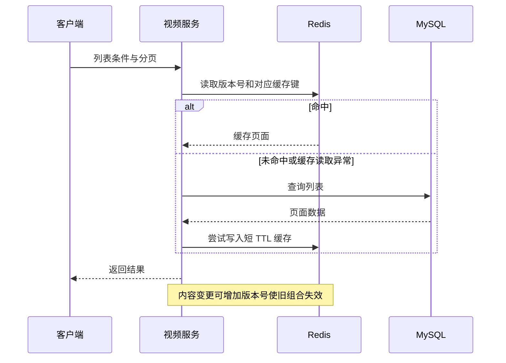

# 亮点十：读路径缓存、布隆过滤与搜索体验

[返回总览](README.md)。索引重建见[搜索恢复](03-search-recovery.md)，本篇关注在线查询。

## 问题与方案

列表、详情和搜索重复访问会放大数据库及 ES 压力；不存在的视频 ID 会产生无效查询。项目采用详情缓存、列表短缓存、搜索结果缓存和 Redis 位图布隆过滤器。

列表默认缓存 5 秒，键包含版本、分页、分类、作者与排序；失效时增加版本号，旧键等待 TTL 回收，避免枚举删除所有筛选组合。布隆过滤器使用 5 个哈希位置，尚未准备好、位图丢失或 Redis 异常时放行，避免把基础设施异常直接当作不存在。

搜索只检索已发布文档，支持关键词、分类、排序和分页；建议词取标题前缀并去重。热搜用有界 Redis ZSet，Lua 将计分和裁剪组合执行。搜索结果是派生数据，不承担发布状态的最终事实源。

## 核心时序：列表查询

## 故障案例与验证

[历史读压报告](../../loadtest/PERFORMANCE_REPORT.md)记录某次本地核心链路约 300 RPS、5 分钟读压，以及当时的缓存、索引和连接池调整；[后续分场景基线](../reports/2026-09-18-p2-capacity-baseline.md)的资源限制和持续时间不同，不能拼接成同一组容量数据。

[搜索服务测试](../../bilibili-search-service/src/test/java/com/gary/bilibili/search/service/impl/SearchServiceImplTest.java)与[视频服务测试](../../bilibili-video-service/src/test/java/com/gary/bilibili/video/service/impl/VideoServiceImplTest.java)是功能证据入口，不是缓存击穿压测。建议演练：删除布隆位图、Redis 断开、热门缓存同时到期；观察正确性和数据库压力。本次未执行。

## 设计取舍、局限与追问

- **布隆过滤器能证明存在吗？** 不能，可能误判，数据库仍需校验。理论无假阴性依赖插入完整，应用更新失败也需要单独处理。
- **短 TTL 等于强一致吗？** 不等于。数据库查询和缓存回填之间有竞态，版本化失效也不是事务屏障；搜索还叠加 CDC 延迟。
- **缓存故障是否完全无影响？** 部分读取会回源，但增加数据库/ES 压力；其他认证或限流路径可能仍依赖 Redis，不能宣称全站无损降级。
- **是否解决热点击穿和深分页？** 当前材料不声称具备全链路 single-flight、逻辑过期或 search_after；这些需要明确实现和测量后再讲。
- **热搜能防刷吗？** 有界集合控制空间，不等于按用户去重、防机器人或时间衰减的榜单。

## 90 秒讲述稿

> 在线读路径使用不同粒度的缓存：详情按视频，列表按筛选条件和版本，搜索缓存结果。列表版本号失效避免枚举删除大量组合，旧缓存靠 TTL 回收。布隆过滤器减少无效 ID 查询，但未初始化和异常时会放行，以正确性优先。历史读压能证明特定环境下的效果，不能证明生产容量，也不能把缓存策略等同于强一致。热点同时失效和 CDC 延迟仍是需要量化的边界。

源码：[列表缓存](../../bilibili-video-service/src/main/java/com/gary/bilibili/video/service/VideoListCache.java)、[布隆过滤器](../../bilibili-video-service/src/main/java/com/gary/bilibili/video/service/VideoBloomFilter.java)、[搜索](../../bilibili-search-service/src/main/java/com/gary/bilibili/search/service/impl/SearchServiceImpl.java)、[搜索缓存](../../bilibili-search-service/src/main/java/com/gary/bilibili/search/service/SearchResultCache.java)。
