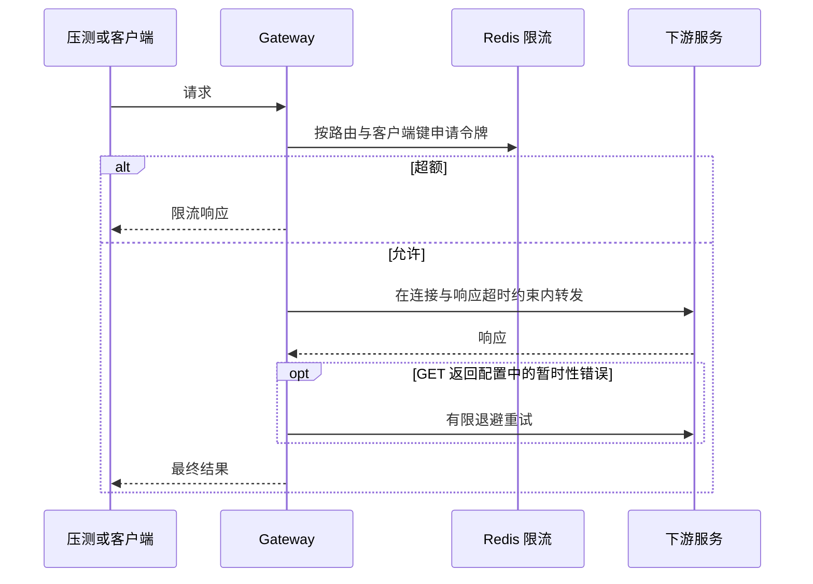

# 亮点十一：网关保护与可解释的容量基线

[返回总览](README.md)。限流配置是保护策略，压测证据才回答系统实际能承受多少。

## 问题与方案

流量超过下游处理能力会占满线程和连接；无限重试会放大故障。Gateway 按路由配置 Redis 令牌桶，使用客户端 IP 作为键，对认证、刷新、视频、社交、搜索与运维设置不同配额。连接池、连接等待及响应超时限制请求占用。

默认重试仅针对 GET 的 502/503/504，最多额外重试两次并退避；不自动重试普通写请求。真实客户端 IP 默认不相信 `X-Forwarded-For`，只有配置可信代理路径后才应开启读取该头。

容量测试区分读、写、弹幕与转码，记录延迟、错误、资源和 MQ 积压。CPU 门禁按容器核配额归一化，而不是把 Docker 原始百分比直接当成配额利用率。

## 核心时序

图描述策略逻辑，不表示过滤器在所有路由上的精确执行顺序。

## 故障案例与验证

历史发现资源口径不一致，修复采用 `cpuQuotaPercent = rawCpuPercent / quotaCores`：4 核容器原始 200% 表示使用配额的 50%，见[CPU 门禁报告](../reports/2026-09-17-cpu-quota-gate.md)。该报告中的完整发布曾因 Docker 不可用失败，不能因为算法校验通过就改称发布成功。

[分场景容量报告](../reports/2026-09-18-p2-capacity-baseline.md)记录 30 秒测量：读约 150 HTTP RPS、评论写约 1 operation/s、弹幕约 1 message/s、转码约 1 task/s。另一次约 300 HTTP RPS 试跑触及 Gateway 资源门禁。这些是不同场景，不是统一高并发容量。

## 设计取舍、局限与追问

- **为什么按 IP？** 易实现但 NAT 用户共享额度，代理配置错误还可能把所有用户视为一个地址；开启转发头信任必须保证入口无法伪造。
- **限流阈值是否容量？** 不是。它是配置，真实容量取决于数据规模、资源、请求混合和延迟目标。
- **为什么只重试 GET？** 降低重复写入风险，但 GET 也需要遵循无业务副作用的约定；重试仍会消耗下游资源。
- **吞吐与延迟怎么讲？** 同时给出实际到达率、完成率、P95/P99、错误、资源和积压。限流拒绝不能从错误统计里悄悄删除。
- **下一步如何测？** 固定提交与配额，充分预热，逐级负载并重复运行；分别确认稳态、饱和边界与停止加压后的恢复，不把短突发推导成长期 SLO。

## 90 秒讲述稿

> 网关主要限制超载传播：按路由限流，约束连接池和超时，只对指定 GET 错误有限退避。项目还修正过 CPU 门禁口径，使用容器实际核配额归一化，避免同一个百分比在不同容器上被误读。面试中我会把配置能力和实测容量分开：已有报告是本地固定资源短时测量，不能直接写生产高并发；弹幕事务实现变更后还需要重新测试。

源码与工具：[IP 解析](../../bilibili-gateway/src/main/java/com/gary/bilibili/gateway/GatewayRateLimitConfiguration.java)、[网关配置](../../bilibili-gateway/src/main/resources/application.yml)、[资源归一化](../../scripts/loadtest/resource-normalization.ps1)、[压测说明](../../loadtest/README.md)。
