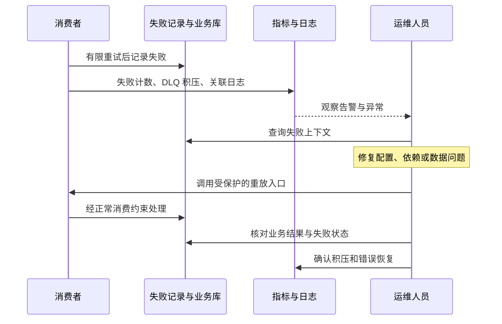

# 亮点十二：可观测性与失败消息恢复

[返回总览](README.md)。强调从异常发现到定位、处置、确认恢复的闭环。

## 问题与方案

异步系统里 HTTP 成功不等于转码、索引或消息消费已完成。项目结合接口耗时、错误率、JVM、MQ 积压、Outbox 待发与应用 DLQ 指标，并以日志中的 requestId、traceId 辅助定位。

Servlet 请求过滤器校验或生成请求 ID，把当前 Trace ID 写入响应和 MDC，请求结束恢复原 MDC，避免复用线程串日志。接口指标使用有限的业务分类标签，不把用户 ID 或完整动态 URL 作为指标标签。Prometheus、Grafana、Alertmanager、Loki、Tempo 相关配置与运维手册提供监控排障入口。

失败消息有持久化记录、查询和重放入口；先排除持续失败根因，再重放并确认业务结果。幂等边界和外部副作用限制仍见[消息一致性](02-message-consistency.md)。

## 核心时序：定位并恢复消费失败

## 故障案例与验证

[可靠性运行手册](../runbooks/observability-and-reliability.md)提供告警、日志查询及 DLQ 操作说明；[失败消息服务测试](../../bilibili-common-reliability/src/test/java/com/gary/bilibili/common/reliability/FailedMessageAdminServiceTest.java)提供重放行为断言。[索引演练报告](../reports/2026-09-18-index-cutover-lock-cdc-backlog.md)记录过失败诊断保存递归日志对象导致 JSON 序列化耗尽内存，改用纯文本日志后保留失败证据。

这是“故障诊断本身也要可靠”的真实例子。未在本次确认监控 UI、告警接收渠道或端到端 Trace 链路处于运行状态。

## 设计取舍、局限与追问

- **requestId 与 traceId 是一回事吗？** 前者用于请求关联，后者来自 tracing 上下文；没有活动 Span 时生成的标识不等于存在完整分布式 Trace。
- **HTTP 200 是否表示业务成功？** 未必。统一响应体可能包含业务失败，所以压测需要同时检查协议和业务结果。
- **为什么不把所有数据做指标标签？** 用户、消息键等高基数标签会膨胀时间序列，应放在受控日志或查询记录中。
- **重放等于修复吗？** 不是。根因未解除会再次失败，外部副作用还需要独立幂等。手工重放也应验证权限、范围和最终结果。
- **仍需完善什么？** 告警送达实测、数据保留与敏感字段策略、故障恢复时长分布；不能用“部署了 Grafana”代替这些证据。

## 90 秒讲述稿

> 可观测性的目标是定位业务卡在哪一段。项目记录接口延迟与请求关联信息，也关注异步积压和失败消息。处理失败时先查记录和日志、修根因、再重放，并用业务结果和积压收敛确认恢复。历史演练还出现过诊断对象递归导致报告生成失败，说明失败证据本身需要简洁、可靠地保存。当前有代码和运行手册，但不能把配置存在解释成告警已经送达或完整追踪已经验证。

源码：[请求观测过滤器](../../bilibili-common-web/src/main/java/com/gary/bilibili/common/observability/RequestObservabilityFilter.java)、[慢查询拦截器](../../bilibili-common-web/src/main/java/com/gary/bilibili/common/observability/SlowQueryInterceptor.java)、[失败消息管理](../../bilibili-common-reliability/src/main/java/com/gary/bilibili/common/reliability/FailedMessageAdminService.java)。
