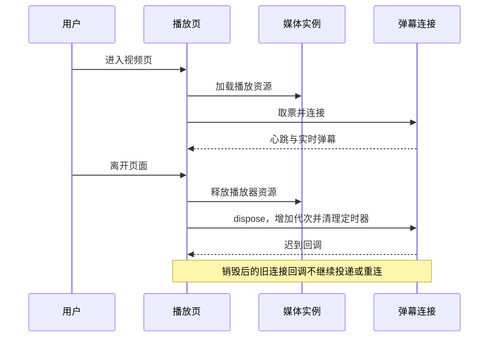

# 亮点十三：前端业务恢复与媒体播放生命周期

[返回总览](README.md)。本篇将前后端接口能力组织成可演示的用户旅程。

## 问题与方案

页面调用接口成功不代表用户真正看到视频；网络中断、访问令牌过期、重复挂载和离开页面会产生恢复与资源释放问题。

Vue 页面承载登录、上传、搜索、播放、治理与创作者看板；HTTP 刷新、分片上传、弹幕连接分别封装为服务，避免页面复制恢复逻辑。播放页使用 HLS.js 或浏览器能力处理媒体，支持清晰度选择；切换或销毁时释放相关实例和连接。HTTP 错误通过统一封装传递，弹幕连接用 generation 防止旧异步回调继续生效。

媒体服务支持首档先发布、多档 HLS、封面与编码器选择/回退；这些是实现能力，不代表所有 GPU 和浏览器组合都验证过，转码恢复见[专题一](01-media-recovery.md)。

## 核心时序：用户离开播放页

## 故障案例与验证

[浏览器旅程](../../bilibili-web/e2e/journey.spec.ts)在真实页面上使用确定性网关/API 与 WS 桩，覆盖业务旅程、401 恢复、分片失败续传及创作者看板。[历史前端报告](../reports/2026-09-17-frontend-regression.md)记录 Chromium 用固定 WebM 样本断言播放时间实际前进；不是仅检查 video 标签存在。

[连接测试](../../bilibili-web/src/services/danmuConnection.test.ts)验证离开后不重连、不接收旧消息；[上传测试](../../bilibili-web/src/services/chunkUpload.test.ts)验证失败后的恢复。当前没有据此证明真实 HLS 全编码器矩阵、移动端浏览器或无障碍全面通过。

## 设计取舍、局限与追问

- **为什么用接口桩？** 确定性强，容易注入错误和检查 UI；代价是发现不了后端接口契约漂移、跨域、签名域名或真实编解码问题。
- **为什么还要真实 Compose E2E？** 它检查真实依赖与业务状态。最好再增加真实后端的浏览器主流程，两类证据互补。
- **generation 有何用途？** 区分当前连接生命周期和已销毁的旧异步任务，关闭 socket 本身并不自动取消已经完成的取票回调。
- **前端恢复是否端到端幂等？** 不能。恢复只是重试策略，服务端还需重复请求与状态约束。
- **页面是否已经足够解耦？** 已拆出部分服务，但复杂页面仍可按播放器、互动面板和状态管理继续拆分；不要把所有 View 都描述成很小的组件。

## 90 秒讲述稿

> 前端亮点是把恢复逻辑从页面中分离：认证过期统一刷新，上传中断重新查询进度，弹幕断线重新取票，退出页面取消定时器并隔离旧回调。浏览器测试不仅检查页面出现，还检查媒体播放时间前进。不过测试使用确定性接口桩，因此它证明前端交互与恢复，不证明真实媒体和后端全部打通。演示时应结合真实 Compose 链路，并继续补真实浏览器端到端验收。

源码：[播放页](../../bilibili-web/src/views/VideoView.vue)、[上传页](../../bilibili-web/src/views/UploadView.vue)、[连接封装](../../bilibili-web/src/services/danmuConnection.ts)、[浏览器工作流](../../.github/workflows/frontend-browser.yml)。
