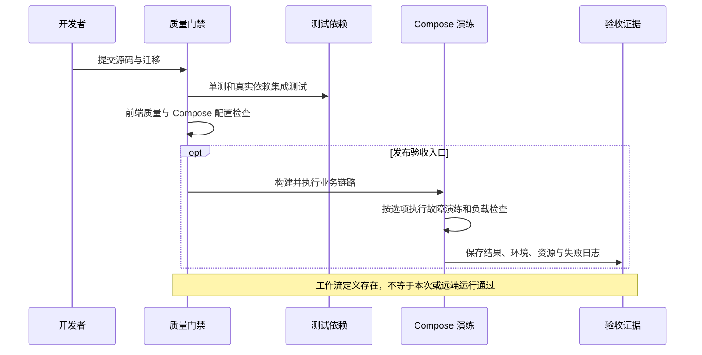

# 亮点十四：模块边界、数据迁移与可复现交付

[返回总览](README.md)。本篇用于回答“为什么这样拆”和“怎样保证换环境还能运行”。

## 问题与方案

项目包含用户、视频、弹幕、社交、搜索、Canal、Gateway 和 common。模块按业务或基础设施职责组织，Maven 多模块构建；媒体长任务与普通消息消费分开，搜索维护与查询分开，前端独立构建。

数据库通过 Flyway 版本迁移统一管理：业务基表、索引、Outbox/Inbox、内容治理、转码租约、补偿、创作者统计和 Inbox fencing 分步演进。DTO 表达输入，VO 表达输出，实体/Mapper 或 Repository 处理持久化；复杂逻辑逐步抽到专门服务。

后端以 Maven verify 接入单测、Failsafe 集成测试和覆盖率；真实依赖用 Testcontainers。前端 quality 包含 lint、覆盖率测试和类型检查/构建，浏览器测试独立工作流。Compose、环境配置和发布脚本连接构建、真实 E2E 与可选故障/容量验证。

## 核心时序：变更交付

## 故障案例与验证

历史 CI 拉取 MinIO 镜像 404，本机因缓存而未暴露；统一 Compose 与 Testcontainers 镜像来源后，本地真实拉取和回归通过，见[镜像源修复报告](../reports/2026-09-20-minio-registry-ci-fix.md)。这是可复现交付问题，不是业务断言失败。报告明确远端恢复需查看新运行结果，本次未查远端。

另有 Linux curl 解析与脚本跨平台修复记录，说明 Windows 本地通过不能自然推出 Linux CI 通过。当前后端 20% 行覆盖率下限只是低基线，且排除结构代码；不能将前端局部高覆盖率移植成全项目覆盖率。

## 设计取舍、局限与追问

- **这是真正独立数据库的微服务吗？** 当前共享数据库，部分模块跨域表查询和聚合，迁移由 common 统一维护。可称按服务拆分的演示架构，不应声称完全自治的数据边界。
- **小项目为何使用微服务？** 展示异步通信、故障隔离和部署协作；实际代价是依赖多、资源占用和排障复杂。小团队也可以保留模块边界部署成模块化单体。
- **common 会成为耦合中心吗？** 会有风险。保留稳定基础设施能力，避免不断放入业务对象和跨域编排；当前共享依赖仍需持续控制。
- **迁移可以任意回滚吗？** 不能。数据库结构与旧消费者 SQL 可能不兼容，尤其租约字段升级应遵循停止旧实例、迁移、启动新版本的既有边界。
- **测试分层怎样分工？** Mock 测分支，真实数据库测 SQL/事务，Compose 测集成，浏览器测交互，故障注入测恢复，压测测给定环境容量，任何一层不能代替全部。

## 90 秒讲述稿

> 工程化部分重点是边界和可复现。项目按职责拆服务，但目前仍共享数据库，不能假装已经做到完全独立微服务。Flyway 管理结构演进，Testcontainers 检查真实 SQL 和事务，Compose 验证依赖协作，前端与浏览器门禁检查交互。一个真实案例是本地缓存掩盖了 MinIO 镜像不可拉取，到了干净 CI 才失败，所以交付验收必须记录镜像和环境。覆盖率数字只是辅助，更关键的是关键不变量和故障路径有没有对应证据。

入口：[构建与覆盖率](../../pom.xml)、[数据库迁移](../../bilibili-common/src/main/resources/db/migration)、[CI](../../.github/workflows/ci.yml)、[发布验收脚本](../../scripts/verification/release-validation.ps1)、[部署说明](../../README.md)。
