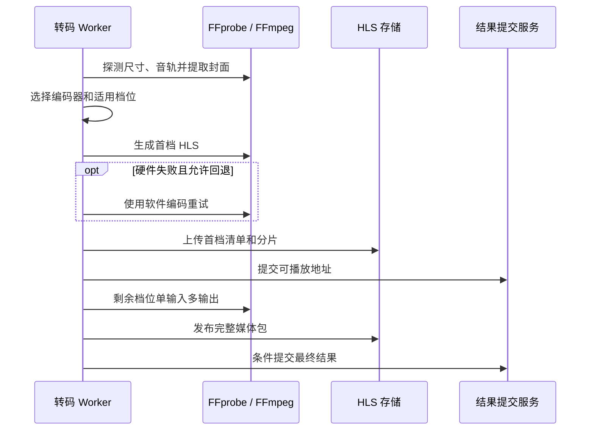

# 亮点十五：渐进式多档 HLS 与编码器回退

[返回总览](README.md)。本篇解释媒体处理效率；任务接管和发布安全见[可靠转码](01-media-recovery.md)。

## 问题与方案

源视频的分辨率、比例和音轨不统一，用户不应一直等到全部清晰度完成；为每档分别启动完整解码又有重复开销。

项目通过 FFprobe 获取媒体属性，选择适用档位并计算缩放尺寸，提取封面。开启渐进发布时先生成首档并发布可播放结果，剩余档位通过一个 FFmpeg 输入和 split/filter graph 分配输出，生成 Master Playlist、子清晰度清单与分片。

编码器选择支持软件、NVIDIA、Intel QSV 与 VAAPI；自动选择同时检查 FFmpeg 暴露的编码器和容器设备节点，不只相信镜像中的环境变量。硬件处理失败且允许回退时尝试软件编码。对象存储发布仍经过租约检查和独立 attempt 路径。

## 核心时序

图展示开启渐进发布且存在多个档位的路径；单档或关闭渐进发布时不会执行同样的分阶段发布。

## 故障案例与验证

[命令构造测试](../../bilibili-video-service/src/test/java/com/gary/bilibili/video/service/HlsTranscodeCommandBuilderTest.java)检查软件多档使用一个输入、split 图与正确流映射，也检查 VAAPI 上传过滤器和无音轨分支。[缩放测试](../../bilibili-video-service/src/test/java/com/gary/bilibili/video/service/VideoScaleGeometryTest.java)提供尺寸计算验证。[媒体演示手册](../MEDIA_GOVERNANCE_RUNBOOK.md)说明配置与演练入口。

首档发布后 Worker 崩溃的真实历史演练见[补偿报告](../reports/2026-09-18-transcode-attempt-cleanup-rendition-recovery.md)。它不等于已注入硬件编码失败。建议另测设备未挂载、编码器不可用、无音轨、竖屏、异常输入和超时；本次没有运行该矩阵。

## 设计取舍、局限与追问

- **一次解码覆盖全部流程吗？** 不覆盖。首档和剩余档位是不同阶段，封面提取也是单独处理；“一次输入多档”只描述同批剩余档位的命令结构。
- **首档优先能加速什么？** 缩短用户等待首个可播放结果的路径，不必然降低全部档位总耗时。没有同输入对照数据时不写提升百分比。
- **硬件可用检查等于驱动完全兼容吗？** 不是，实际编码仍可能失败，所以保留回退；软件回退会改变 CPU 压力和队列吞吐。
- **配置 CDN 地址等于上线 CDN 吗？** 不是。地址前缀与缓存策略只是接入能力，需要实际分发、回源与缓存失效验证。
- **首档和高档位是完全独立资源吗？** 它们共享源视频与任务生命周期；补偿可能重做部分编码，源视频清理策略也会影响可恢复性。

## 90 秒讲述稿

> 媒体处理采用首档优先，让视频先可播放，再补齐清晰度。剩余档位在同一个 FFmpeg 输入上分流处理，减少同一批次重复解码；编码器自动选择同时看编码能力和真实设备节点，失败时可以回退软件。测试能验证命令结构和缩放逻辑，真实容器演练能验证产物及崩溃恢复，但两者都不能证明全部 GPU 驱动兼容或固定加速比。性能表述应分别测首档时间、全部完成时间和资源成本。

源码：[处理 Worker](../../bilibili-video-service/src/main/java/com/gary/bilibili/video/service/FfmpegVideoTranscodeWorker.java)、[编码器选择](../../bilibili-video-service/src/main/java/com/gary/bilibili/video/service/VideoEncoderSelector.java)、[命令构造](../../bilibili-video-service/src/main/java/com/gary/bilibili/video/service/HlsTranscodeCommandBuilder.java)、[缩放几何](../../bilibili-video-service/src/main/java/com/gary/bilibili/video/service/VideoScaleGeometry.java)。
