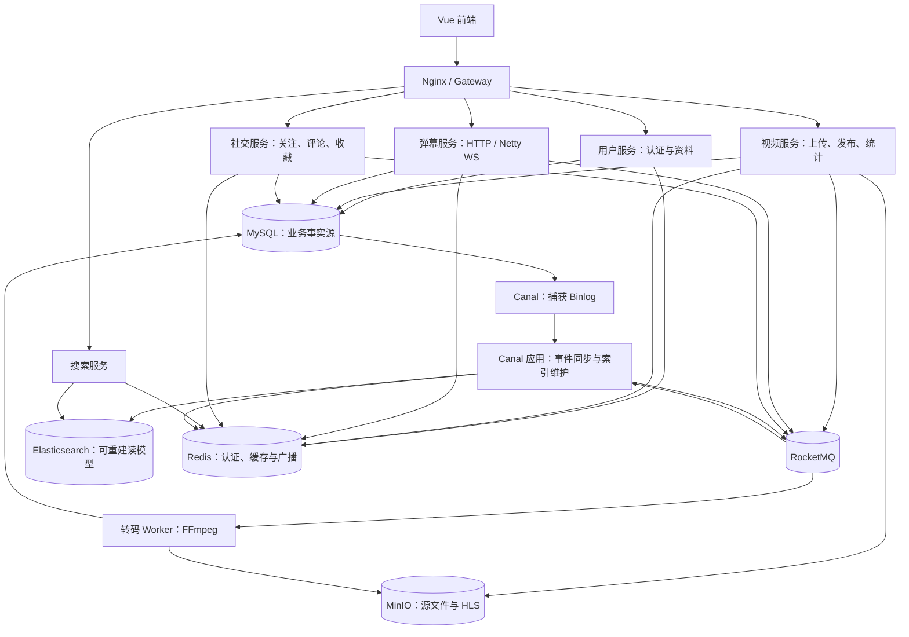

# Bilibili Cloud 面试材料

整理日期：2026-11-01。源码核对基线：`ed2dcb2`。面向 Java 后端实习面试。

本文档依据当前源码、测试用例和仓库历史验收报告整理，本次仅做文档核对，没有重新执行业务测试、压测或故障注入。报告中的通过次数和耗时属于当时环境，不代表当前提交再次通过或生产表现。讲述稿需要结合本人实际参与范围使用，不能把仓库中全部实现都描述成个人独立完成。

## 1. 一分钟项目介绍

> 这是一个基于 Java 21、Spring 和 Vue 的视频平台，覆盖上传、转码、发布、播放、弹幕、互动和搜索。我重点准备了三个技术问题：长时间转码任务崩溃后如何安全接管；消息重复投递时如何保证数据库业务不重复提交；搜索索引重建时如何保留查询入口并处理并发 CDC。项目使用数据库租约和代次隔离旧 Worker，通过 Outbox、Inbox 和本地事务处理消息一致性，通过影子索引和 Alias 切换恢复搜索读模型。验证主要来自本地集成测试和真实容器故障演练，目前没有生产流量或生产容量结论。

## 2. 架构图

以下是职责视图，省略端口、逐服务注册关系和监控连接；完整部署拓扑见[项目 README](../../README.md)。

架构分工：MySQL 保存业务事实；MinIO 保存大对象；MQ 解耦耗时操作并允许重试；Redis 承担短期状态与实时广播；ES 承担检索。数据库事务不能原子提交 MQ、对象存储和 ES，因此三个亮点都围绕失败后的收敛设计。

## 3. 三个技术亮点

| 亮点 | 面试核心问题 | 阅读入口 |
| --- | --- | --- |
| 可靠转码与崩溃接管 | 锁过期后旧 Worker 还在运行，怎样防止它覆盖新结果？ | [媒体处理](01-media-recovery.md) |
| 可靠消息与数据库幂等 | 只判断“消息处理过没有”为什么还不够？ | [消息一致性](02-message-consistency.md) |
| 搜索索引恢复 | 重建与 CDC 并发时，怎样避免旧数据覆盖和错误切换？ | [搜索恢复](03-search-recovery.md) |

每份材料按“问题→方案→时序→故障→验证→取舍→讲述稿”组织。面试先选一个讲深，其余作为追问方向。

## 4. 简历表述候选

以下是实现描述，使用前确认能解释对应代码，以及个人负责范围；暂不添加未经当前版本复验的性能数字。

- 设计视频异步转码流程，通过数据库租约、代次与令牌校验隔离过期 Worker，结合独立 HLS 产物目录和事务提交支持崩溃接管及高档位失败补偿。
- 基于事务 Outbox、消费 Inbox 与失败重放构建消息可靠性机制，使用领取凭据和行锁保护数据库业务与消费状态的原子提交，处理重复投递及租约接管竞态。
- 实现 Elasticsearch 影子索引重建与 Alias 切换，通过跨实例协调、切换前对账及 CDC 回查 MySQL 当前状态处理并发重建和晚到事件。

避免写“全链路 Exactly Once”“生产级高可用”“零延迟同步”“百万并发”。历史短时读压、低速写压、转码测量不能相互替代。

## 5. 演示与答辩准备

1. 用业务界面说明上传、发布、播放和搜索，先让面试官理解系统解决什么问题。
2. 打开一个时序图，解释正常路径，再插入故障点；用任务代次、Inbox 记录或 Alias 指向说明恢复结果。
3. 展示对应测试和历史报告，说明验证环境、断言与未覆盖场景。原始报告目录常被 Git 忽略，演示前确认文件存在或重新生成。
4. 准备回答：为什么需要微服务、当前单数据库部署的边界是什么、如果缩小规模如何简化。可以说明单体也能承载这些一致性设计；本项目服务拆分便于演示职责与故障隔离，尚无生产规模证明必须微服务化。

验收工具已在仓库中：后端 `mvn -s .mvn/settings.xml --batch-mode --no-transfer-progress verify`；前端在 `bilibili-web` 执行 `npm run quality`；端到端入口为 `scripts/e2e/reliability-e2e.ps1`。故障脚本会启动或操作容器并创建、清理测试数据，应在隔离的本地演练环境运行。上述命令本次未执行。
