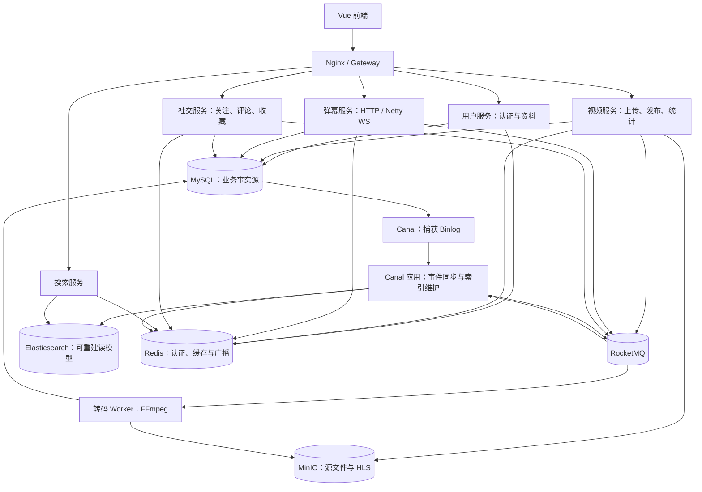

# Bilibili Cloud 全项目面试材料

整理日期：2026-11-01。仓库核对基线：`f7721df`，最近业务代码提交为 `ed2dcb2`。面向 Java 后端实习面试，覆盖全项目主要业务与工程模块。

本文档依据当前源码、测试用例和仓库历史验收报告整理，本次仅做文档核对，没有重新执行业务测试、压测或故障注入。报告中的通过次数和耗时属于当时环境，不代表当前提交再次通过或生产表现。讲述稿需要结合本人实际参与范围使用，不能把仓库中全部实现都描述成个人独立完成。

证据分为三类：**历史实测**附日期和报告；**现有用例**表示当前有对应断言，不表示本次通过；**建议演练**是待执行方案，不是已发生事故。一般实现分析不自动升级为实测结论。

## 1. 一分钟项目介绍

> 这是一个基于 Java 21、Spring 和 Vue 的视频平台，覆盖上传、转码、发布、播放、弹幕、互动和搜索。我重点准备了三个技术问题：长时间转码任务崩溃后如何安全接管；消息重复投递时如何保证数据库业务不重复提交；搜索索引重建时如何保留查询入口并处理并发 CDC。项目使用数据库租约和代次隔离旧 Worker，通过 Outbox、Inbox 和本地事务处理消息一致性，通过影子索引和 Alias 切换恢复搜索读模型。验证主要来自本地集成测试和真实容器故障演练，目前没有生产流量或生产容量结论。

## 2. 架构图

以下是职责视图，省略端口、逐服务注册关系和监控连接；完整部署拓扑见[项目 README](../../README.md)。

架构分工：MySQL 保存业务事实；MinIO 保存大对象；MQ 解耦耗时操作并允许重试；Redis 承担短期状态与实时广播；ES 承担检索。数据库事务不能原子提交 MQ、对象存储和 ES，因此跨组件操作都需要解释失败边界。部署、数据库共享与质量门禁见第十四篇。

## 3. 全项目专题导航

| 亮点 | 面试核心问题 | 阅读入口 |
| --- | --- | --- |
| 可靠转码与崩溃接管 | 锁过期后旧 Worker 还在运行，怎样防止它覆盖新结果？ | [媒体处理](01-media-recovery.md) |
| 可靠消息与数据库幂等 | 只判断“消息处理过没有”为什么还不够？ | [消息一致性](02-message-consistency.md) |
| 搜索索引恢复 | 重建与 CDC 并发时，怎样避免旧数据覆盖和错误切换？ | [搜索恢复](03-search-recovery.md) |
| 登录与认证 | 一次性刷新凭据遇到并发 401 怎么处理？ | [会话轮换](04-auth-session.md) |
| 大文件上传 | 如何恢复进度、处理重复分片和直传核验？ | [续传与直传](05-upload-resume.md) |
| 实时弹幕 | 在线广播、历史持久化和连接恢复怎样分工？ | [弹幕系统](06-danmu-realtime.md) |
| 社交互动 | 重复操作、权限和异步计数各有什么保证？ | [关系与计数](07-social-interactions.md) |
| 创作者数据中心 | 重复、迟到和历史关系变化怎样重算？ | [可重算统计](08-creator-analytics.md) |
| 内容治理 | 媒体可播放与允许公开如何区分？ | [审核与举报](09-content-governance.md) |
| 在线查询 | 缓存、布隆过滤和热搜如何减轻读压力？ | [缓存与搜索](10-read-cache-search.md) |
| 网关与性能 | 限流策略与实测容量为什么不能混为一谈？ | [流量保护](11-gateway-capacity.md) |
| 运维恢复 | 如何从积压定位失败并确认恢复？ | [可观测性](12-observability-recovery.md) |
| 前端与播放 | 页面退出、断网、媒体播放如何可靠验证？ | [交互恢复](13-frontend-playback.md) |
| 架构与交付 | 服务边界、数据迁移和环境复现怎样解释？ | [工程化](14-architecture-quality.md) |
| 媒体编码 | 首档优先、多输出与硬件回退有什么代价？ | [多档 HLS](15-media-encoding.md) |

每份材料按“问题→方案→时序→故障→验证→取舍→讲述稿”组织。01—03 是主讲候选，04—15 是按岗位选择的拓展，不建议在一次面试中机械罗列十五项。

业务阅读顺序：04 登录 → 05 上传 → 15 编码 → 01 接管 → 09 审核 → 13 播放 → 06 弹幕 → 07 互动 → 08 看板 → 10 检索。分布式专题顺序：02 消息 → 03 索引 → 11 容量 → 12 运维 → 14 架构。

## 4. 简历表述候选

以下是实现描述，使用前确认能解释对应代码，以及个人负责范围；暂不添加未经当前版本复验的性能数字。

- 设计视频异步转码流程，通过数据库租约、代次与令牌校验隔离过期 Worker，结合独立 HLS 产物目录和事务提交支持崩溃接管及高档位失败补偿。
- 基于事务 Outbox、消费 Inbox 与失败重放构建消息可靠性机制，使用领取凭据和行锁保护数据库业务与消费状态的原子提交，处理重复投递及租约接管竞态。
- 实现 Elasticsearch 影子索引重建与 Alias 切换，通过跨实例协调、切换前对账及 CDC 回查 MySQL 当前状态处理并发重建和晚到事件。

可按岗位替换其中一条：

- 基于事件去重、脏日期与版本检查实现创作者日统计重算，支持迟到数据补算、趋势查询与登录身份隔离。
- 实现分片续传与预签名直传，按服务端进度恢复缺失分片，并在服务端校验上传归属与对象后衔接异步转码。
- 将弹幕在线广播与最终持久化分层，结合一次性 Ticket、房间隔离和客户端生命周期管理实现连接恢复。

避免写“全链路 Exactly Once”“生产级高可用”“零延迟同步”“百万并发”。历史短时读压、低速写压、转码测量不能相互替代。

## 5. 演示与答辩准备

1. 用业务界面说明上传、发布、播放和搜索，先让面试官理解系统解决什么问题。
2. 打开一个时序图，解释正常路径，再插入故障点；用任务代次、Inbox 记录或 Alias 指向说明恢复结果。
3. 展示对应测试和历史报告，说明验证环境、断言与未覆盖场景。原始报告目录常被 Git 忽略，演示前确认文件存在或重新生成。
4. 准备回答：为什么需要微服务、当前单数据库部署的边界是什么、如果缩小规模如何简化。可以说明单体也能承载这些一致性设计；本项目服务拆分便于演示职责与故障隔离，尚无生产规模证明必须微服务化。

验收工具已在仓库中：后端 `mvn -s .mvn/settings.xml --batch-mode --no-transfer-progress verify`；前端在 `bilibili-web` 执行 `npm run quality`；端到端入口为 `scripts/e2e/reliability-e2e.ps1`。故障脚本会启动或操作容器并创建、清理测试数据，应在隔离的本地演练环境运行。上述命令本次未执行。

## 6. 面试前自检

| 检查项 | 应能现场说明 |
| --- | --- |
| 个人贡献 | 哪些自己实现、哪些参考已有代码、哪些只是本次阅读整理 |
| 数据结构 | 任务代次/令牌、Inbox 消费身份、关系唯一键、统计日期版本各约束什么 |
| 事务边界 | 哪些写入同库同事务，哪些 Redis/MinIO/ES 副作用不能回滚 |
| 故障推演 | 在发送前后、领取前后、提交前后杀进程分别发生什么 |
| 测试分层 | 区分 Mock、真实数据库、Compose、浏览器桩和负载测量 |
| 指标证据 | 提交、机器资源、数据规模、持续时间、实际负载及错误口径 |
| 架构取舍 | 共享数据库的耦合、小规模模块化单体替代方案和当前未解决的问题 |

## 7. 知识库版本

完整材料另保存到 Obsidian：`note-java_BackEnd-agent/项目/Bilibili/项目面试材料/`。该目录独立存放总览与十五篇专题，使用中文文件名和相互链接。源码与历史报告链接指向本机项目；迁移电脑时需要同步项目或调整这些外部路径。项目文档是本次材料的原始版本，知识库副本增加属性并转换链接。
